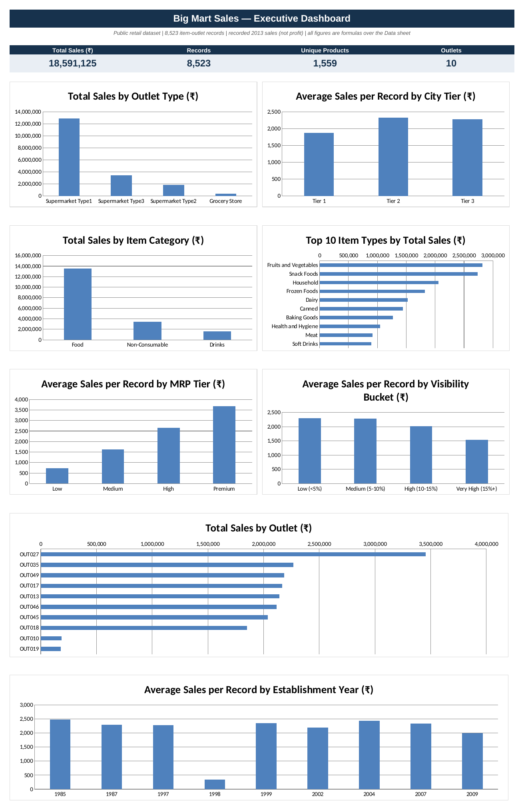

# Big Mart Retail Sales Analysis — India

An end-to-end data analysis project on a public retail dataset, using **Python (Pandas), SQL (MySQL) and Excel**. It takes raw item-outlet data through cleaning, validation, exploratory analysis, business-focused SQL and an Excel dashboard.



## Dataset Source & Attribution

- **Dataset:** BigMart Sales data, originally released as the Analytics Vidhya practice problem [Big Mart Sales III](https://datahack.analyticsvidhya.com/contest/practice-problem-big-mart-sales-iii/) and shared on Kaggle by Yasser H: [BigMart Sales Dataset](https://www.kaggle.com/datasets/yasserh/bigmartsalesdataset).
- **File used:** the 8,523-row training file (`data/raw/bigmart_sales_raw.csv`), 12 original columns. It holds 2013 sales for 1,559 products across 10 outlets.
- **Attribution:** the original dataset is credited to its source. The cleaned CSV, charts, SQL queries and Excel dashboard are derived from this dataset.

> **Scope:** the data is item-outlet sales records with product and outlet attributes. It has no transaction dates, customers, costs or profit, so this project makes no claims about customer retention, repeat orders, margins or sales trends over time.

## Business Questions

1. Which outlet formats and individual outlets account for the most recorded sales?
2. How does average recorded sales vary across the city tiers in the data?
3. Which product categories and item types contribute the most sales?
4. How do price (MRP) bands relate to average recorded sales?
5. What associations appear between MRP, shelf visibility, outlet age and sales?
6. How do grocery stores and supermarket formats differ?
7. Which item types rank highest within each category?

## Key Findings

All figures are recorded 2013 sales in this dataset, in rupees.

- **Scale:** 8,523 item-outlet records, 1,559 unique products, 10 outlets and ₹18.59M in recorded sales.
- **Outlet format:** Supermarket Type1 accounts for the most sales (₹12.92M, about 69.5% of the total). Grocery stores account for about 2.0%.
- **Outlets:** OUT027 (a Supermarket Type3) has the highest sales at about ₹3.45M, roughly 18.6% of the total.
- **City tiers:** Tier 2 has the highest average sales per record (₹2,323.99). Tier 3 has the highest total because it has more records.
- **Categories:** Food is the largest category (₹13.57M). Fruits and Vegetables is the largest single item type (₹2.82M).
- **Price:** higher MRP tiers have higher average sales, and MRP and sales have a Pearson correlation of 0.57. This is an association, not evidence that raising prices increases sales.
- **Shelf visibility:** the correlation between visibility and sales is −0.13, a weak association that should not be read as cause and effect.
- **Establishment year:** average sales by year are not a clean trend. Two of the lowest-selling outlets are grocery stores (one of them is the only outlet established in 1998), so year is mixed up with outlet type.

## Data Cleaning & Validation

`python/01_data_cleaning.py` cleans the raw file and stops with an error if any check fails:

- Standardises `Item_Fat_Content` labels (`LF`, `low fat` → `Low Fat`; `reg` → `Regular`) and labels all 1,599 non-consumable records `Non-Edible`, because a non-consumable item cannot be low fat.
- Removes exact duplicate rows (none were found).
- Fills 1,463 missing `Item_Weight` values using the same product's mean weight in other outlets, then the item-type median, then the overall median.
- Fills 2,410 missing `Outlet_Size` values using the most common size for the outlet's type. **This is an assumption, not recovered data:** three whole outlets (OUT010, OUT017, OUT045) have no size at all. The `Outlet_Size_Imputed` column marks these records.
- Treats 526 `Item_Visibility` values of exactly 0 as missing and fills them from the same product, then the item type.
- Adds `Outlet_Age` (measured in 2013), `Item_Category`, `Price_Per_Unit_Weight`, `MRP_Tier` and `Outlet_Size_Imputed`.
- **Checks at the end of the script:** 8,523 rows, no missing values, no zero visibility, only the expected fat-content labels, each item-outlet pair appears once, and all sales values are positive.

## SQL Analysis

`sql/02_analysis_queries.sql` has 16 MySQL 8+ queries: outlet-format and outlet ranking, city tiers, category and item-type contribution, price tiers, outlet size (with the imputed flag shown), fat content, establishment year, grocery vs supermarket, top products, visibility buckets, outlet share of sales, product presence across outlets, a CTE + window-function ranking of the top 3 item types within each category, and a data-quality check query.

The queries were tested for logic and results against the cleaned data. Run `sql/01_schema.sql`, load the cleaned CSV, then run the queries in MySQL Workbench.

## Excel Dashboard

`excel/BigMart_Sales_Dashboard.xlsx` has four sheets:

- **Dashboard:** 4 KPI cards and 8 charts.
- **Summary:** eight summary tables built with `SUMIFS`, `COUNTIFS` and `AVERAGEIFS` formulas over the Data sheet.
- **Data:** the cleaned dataset (8,523 rows, 17 columns).
- **Data Quality:** cleaning results and notes, including the outlet-size caveat.

The KPI cards and tables are formulas, so they update if the data changes. Only the row labels (outlet names, bucket limits) are typed in, and the Top 10 Item Types list is fixed when the workbook is built. `python/03_build_excel_dashboard.py` rebuilds the workbook from the cleaned CSV.

## Project Structure

```text
bigmart-sales-analysis/
├── README.md
├── requirements.txt
├── data/
│   ├── README.md
│   ├── raw/bigmart_sales_raw.csv
│   └── cleaned/bigmart_sales_cleaned.csv
├── python/
│   ├── 01_data_cleaning.py
│   ├── 02_exploratory_analysis.py
│   └── 03_build_excel_dashboard.py
├── sql/
│   ├── 01_schema.sql
│   └── 02_analysis_queries.sql
├── excel/
│   └── BigMart_Sales_Dashboard.xlsx
└── images/
    └── charts and dashboard preview
```

## Tools

- **Python:** Pandas, NumPy, Matplotlib, openpyxl
- **SQL:** MySQL 8+, aggregations, `CASE`, CTEs, window functions
- **Excel:** `SUMIFS` / `COUNTIFS` / `AVERAGEIFS` formulas, KPI cards, charts

## How to Run

```bash
pip install -r requirements.txt
python python/01_data_cleaning.py
python python/02_exploratory_analysis.py
python python/03_build_excel_dashboard.py   # optional: rebuilds the Excel file
```

Then run `sql/01_schema.sql`, load `data/cleaned/bigmart_sales_cleaned.csv` into the `sales` table, and run `sql/02_analysis_queries.sql`. The rebuilt Excel file has no saved formula results until it is opened and saved in Excel.

## Limitations

- There is no transaction date, so monthly or weekly trends cannot be analysed.
- There is no customer identifier, so retention and repeat-purchase analysis is not possible.
- There are no cost or profit fields, so profitability and margins cannot be analysed.
- The data has city **tiers**, not city names, and covers only 10 outlets in 2013. Results describe this dataset, not Indian retail in general.
- Outlet size is missing for 3 of the 10 outlets (28% of records) and was filled with an assumption. Treat any comparison by outlet size with caution.
- Correlations and group comparisons are descriptive. They do not show cause and effect.

## Takeaway

This project shows a complete analyst workflow: raw data → cleaning with automatic checks → business questions → Python and SQL analysis → Excel dashboard → documented findings and limitations.
